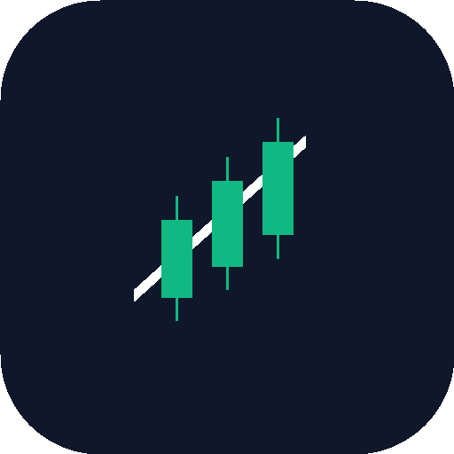

# TradeLog 📈

> A clean, modern, mobile-first trading journal, session alarms, discipline challenges, and performance analytics web application.



## ✨ Key Features

### 1. Dashboard & Overview
- **Core Performance Metrics**: Real-time calculation of Net Profit/Loss, Win Rate (%), Total Trades, Profit Factor, and average Risk-to-Reward.
- **Trading Activity Matrix**: Interactive session $\times$ weekday heatmap (Sydney, Asia, London, New York across Monday–Sunday).
- **Instruments Breakdown**: Trade frequency and profitability breakdown across all traded assets (e.g. XAUUSD, EURUSD).
- **Broker-Day Performance Table**: Daily breakdown of trades, lot size, cash profit (USD), and return %.
- **Interactive Equity Curve**: SVG area chart tracking peak equity and maximum drawdown ($ and %).
- **Discipline Challenge Tracker**: Daily completion progress bar with one-tap habit verification.

### 2. Fast Trading Journal
- Record positions in seconds with entry/exit times, instrument, buy/sell side, trading session, prices, lot size, and risk USD.
- Real-time planned and realized Risk-to-Reward (R:R) computation.
- Chart screenshot uploads with modal preview.
- Emotional state, psychological discipline, and mistake tracking.
- Pre-trade rules verification checklist.
- Full CSV export and CSV broker import support.

### 3. In-Depth Trading Analytics & "Discipline Edge"
- **Discipline Edge Analysis**: Quantifies your exact financial return when following rules vs. breaking rules.
- Breakdown by Trading Session, Instrument, Weekday, and Strategy/Setup.
- Timeframe filters: 7 days, 30 days, 90 days, All time, or Custom date range.
- Real mathematical formulas with zero-division protection.

### 4. Trading Session Alarms & Local Timezones
- Support for Asian, London, London–New York Overlap, and New York sessions.
- Automatic Daylight Saving Time (DST) calculation (British Summer Time and Eastern Daylight Time).
- Local timezone conversion with default **Africa/Addis_Ababa (UTC+3)**.
- Customizable lead-time alarms (0, 5, 10, 15, 30 minutes before session open).
- Web Audio API melodic chimes and browser notifications.
- Session countdown clock and Pre-Session Preparation Checklist.

### 5. Personal Challenges & Habits
- Habit builder for trading routines, fitness, reading, and sleep schedules.
- Current streak and longest streak tracking.
- 14-day history calendar with daily reflection notes.
- Post-session review questionnaire and separate discipline scoring.

### 6. Mobile & Offline Ready (PWA)
- Progressive Web App standard with service worker precaching.
- Installable on Android (WebAPK) and iOS with standalone full-screen windowing.
- Persistent local storage: data stays safely on device after refresh or restart.
- Dark mode and light mode support with zero-latency toggling.

---

## 🚀 Getting Started

### Prerequisites
- Node.js 18+ or Bun
- npm or bun

### Installation
```bash
# Clone the repository
git clone <your-repo-url>
cd tradelog

# Install dependencies
npm install

# Start development server
npm run dev
```

### Production Build
```bash
npm run build
npm run preview
```

---

## 🛠️ Tech Stack
- **Framework**: React 19, TypeScript
- **Bundler**: Vite 8 with `vite-plugin-pwa`
- **Styling**: Tailwind CSS v4
- **Icons**: Lucide React
- **Audio**: Web Audio API (native chimes)
- **Persistence**: Browser LocalStorage & IndexedDB

---

## 📄 License
MIT License
